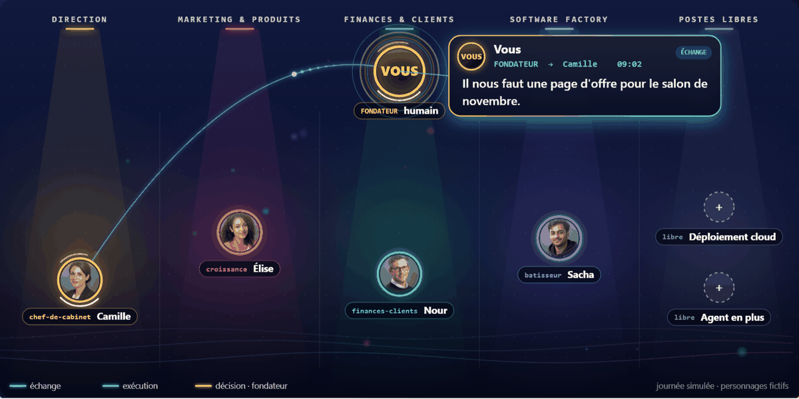

# Zelij Core

**English** · [简体中文](README.zh-CN.md) · [繁體中文](README.zh-TW.md) · [日本語](README.ja.md) · [한국어](README.ko.md) · [Türkçe](README.tr.md) · [Русский](README.ru.md) · [Tiếng Việt](README.vi.md) · [ไทย](README.th.md) · [Deutsch](README.de.md) · [Español](README.es.md) · [Français](README.md) · [Українська](README.uk.md) · [Polski](README.pl.md) · [Português (Brasil)](README.pt-BR.md) · [العربية](README.ar.md) · [فارسی](README.fa.md) · [Bahasa Indonesia](README.id.md) · [Italiano](README.it.md) · [Ελληνικά](README.el.md) · [മലയാളം](README.ml.md) · [Roman Urdu](README.ur.md) · [Română](README.ro.md)

[](https://github.com/zelij-ai/zelij-core/actions/workflows/ci.yml) [](https://github.com/zelij-ai/zelij-core/releases) [](LICENSE)

**Build your 100% AI-native startup.** One office where four agents work for you: they propose, you decide. Your machine, your Claude key, your data; nothing phones home.



*The aquarium, on a simulated day (shown here in French). In your own installation, every card is a real action by your agents, live and replayable over twenty-four hours. Gold is you: nothing binding happens before your decision. The faces are fictional characters.*

## What the core does

- **The office**: one page. Pending decisions, a request to the chief of staff, the latest runs with their cost, the journal, the agents, the installed modules.
- **The decision packet**: objective, proposal, why now, options, recommendation, risks, reversibility, plan, rollback, impact. An incomplete packet does not open. Approve, refuse, or request changes with a mandatory instruction passed to the agent.
- **House rules**: nothing that commits the company (money, public exposure, deletion, anything irreversible) happens without a decision; a fact is dated and sourced or marked "unverified"; the journal is never erased.
- **The gateway**: the founder's Claude key, the cost of every call computed from usage and dated public prices, a monthly ceiling that blocks.
- **The executor**: a bounded call loop (a turn budget per agent), frugal tools, a model refusal treated as a result.
- **Modules**: the only way to extend the core. Stable interface, `pack.json` manifest signed by the publisher with Ed25519, every file's hash covered by the signature, verification before installation. Deployment targets and extra agents all come this way.
- **Finance**: confirmed sales (read-only Stripe import or manual entry with proof), declared recurring expenses, measured agent cost, monthly ledger, CSV export for the accountant. Nothing is filed or invoiced.
- **Contacts**: one card per person, mandatory legal basis, retention period, exchanges, rights exercised; an objecting contact receives nothing more, an expired contact is forgotten and only the rights journal remains.
- **Publishing**: a page written by the marketing agent becomes a draft, then a decision; once approved, it is proposed to the site as a GitHub pull request or a WordPress draft. The last move, merging or publishing, is yours.
- **In your pocket**: every decision reaches your phone, by e-mail with two signed single-use links, or on Telegram with three buttons. You approve from the subway queue; the aquarium moves as soon as you answer. Same gate, same journal as from the desk.
- **Aquarium**: watch your agents work; every bubble is a real action from the last 24 hours, and the dotted rings are open positions. A shareable public page with the "by zelij.ai" badge.
- **Catalogue**: what the free edition does not include, named honestly; a module bought from the publisher installs here, signed and verified. No payment goes through the office.
- **Software factory**: the Builder reads and proposes on a single repository, through pull requests that pass the security gate (300 lines, text only, no secrets, no infrastructure files, no dependency with a known vulnerability via OSV); deployment to a Linux server over SSH or to OVH (domain and DNS through the API) with an atomic switch, a smoke test and rollback; domain probe; daily backup of the office. It never merges, never pays, never touches the office.
- **The agents**: one folder per agent, an `agent.md` with a simple header and instructions in French. Four agents: Camille Aubert (chief of staff), Élise Tanguy (marketing and products), Nour Bellamy (finance and clients), Sacha Ferrand (software factory). The founder talks to each of them from the office; an approved packet that names an agent and a task runs right away, within the approved plan.

## Try it in one minute, no key

```bash
git clone https://github.com/zelij-ai/zelij-core.git && cd zelij-core
docker compose -f docker-compose.demo.yml up --build
```

Open `http://localhost:8000` and enter the demonstration: a fictional company, four simulated agents, decisions to approve, the aquarium replaying their day. No key, no account, no cost; nothing is sent to a model and everything disappears when you stop it. Once convinced, move on to the real installation below. The office itself is in French.

## Run

```bash
cp .env.example .env     # Claude key, ceiling, SECRET_KEY, database password
docker compose up -d --build
```

The office answers on `http://localhost:8000`. Without SMTP, the login link is written to the container logs (`docker compose logs core-app`).

Full guides: **[Installation](docs/INSTALLATION.en.md)** (bare machine → office over https, SMTP, Software factory, backups, troubleshooting), **[User guide](docs/MODE-D-EMPLOI.en.md)** (every page, the agents, decisions, cost). Photos of the founder and agents go in [`portraits/`](portraits/README.md) (README in French).

From the published image, without a local build (`CORE_IMAGE_TAG=v…` in `.env` pins the version):

```bash
docker compose -f docker-compose.yml -f docker-compose.image.yml up -d
```

Locally without Docker:

```bash
pip install -r requirements-dev.txt
uvicorn core.bureau.app:app --reload
```

## Publisher's public key

Catalogue modules are signed by zelij.ai. The public key to set in `ZELIJ_CLE_PUBLIQUE` (already filled in `.env.example`):

```
8da6c92455558c15a1566b333cef22fb5fc60aad9ffbf811f372e4bb7eacc42a
```

## Security

What the core guarantees, and what is tested (`tests/test_securite.py`):

- **Modules**: a module installs and runs only when signed by the publisher (Ed25519), and the signature covers the SHA-256 hash of every code file: a file modified, added or removed after signing takes the module out of play.
- **Login**: single-use 20-minute links, hashed in the database; brakes per address, per IP and global on link requests, so the office never becomes an e-mail relay; without SMTP configured in production, no link is created or logged.
- **Forms**: HMAC session cookie, `HttpOnly`, `SameSite=Strict`, origin check and a per-session anti-CSRF token on every POST.
- **Pages**: strict content security policy (`default-src 'self'`, no inline script, no frames), `nosniff`, `X-Frame-Options`, `Referrer-Policy`, HSTS when the origin is https.
- **Agents**: whatever an agent reads (web page, repository file) reaches it framed as external content, never as instructions; an agent only runs the tools on its sheet and, once it has read private data, can only call the company's own site; it only reads public https addresses (private, loopback, link-local addresses and internal names refused at every redirect hop, capped response); the security gate blocks secrets, infrastructure files, third-party scripts, frames and network calls.
- **Container**: unprivileged user, read-only filesystem, no capabilities, no privilege escalation; the SSH server's host key can be pinned (`SSH_CLE_HOTE`).
- **Accounting export**: cells that look like a spreadsheet formula are neutralized.

Report a vulnerability to `securite@zelij.ai` without publishing it before the fix. Before every release, `pip-audit -r requirements.txt` and `bandit -r core scripts -ll` must come back empty.

## Contributing and versions

`CONTRIBUTING.md` (in French) explains how a contribution makes it into a release, including the rule that a contributed deployment target earns you the matching pack for life. `SECURITY.md` explains how to report a vulnerability. `CHANGELOG.md` says what each version changes and what is left for the founder to do.

## Tests and publication control

```bash
python -m pytest -q
python scripts/controle_publication.py
```

The publication control rejects keys, IP addresses, internal codes, personal e-mail addresses, clear-text passwords, and the terms of a private list (`ZELIJ_CORE_INTERDITS`) that is never part of the repository.

## License

GNU AGPL v3. Copyright (C) 2026 zelij.ai. You may use, modify and redistribute the core, provided you publish your changes under the same license. The full edition that runs zelij.ai remains the publisher's.

by zelij.ai — https://zelij.ai/
